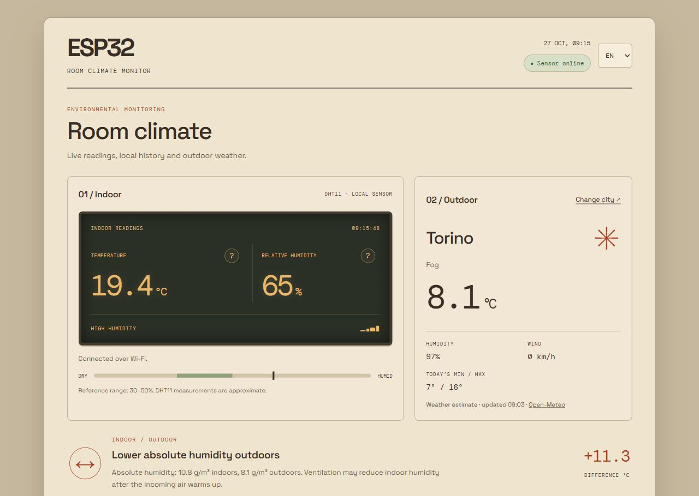
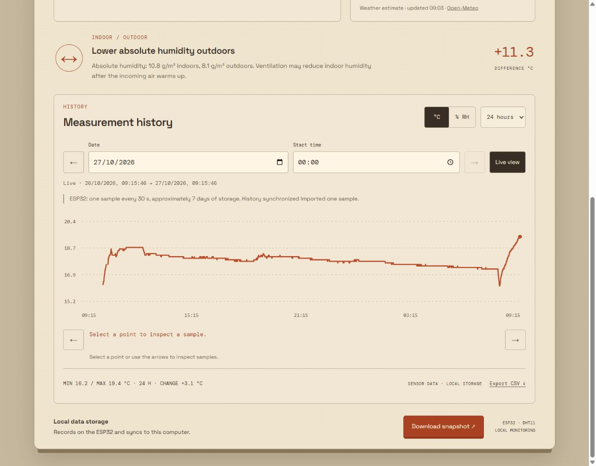
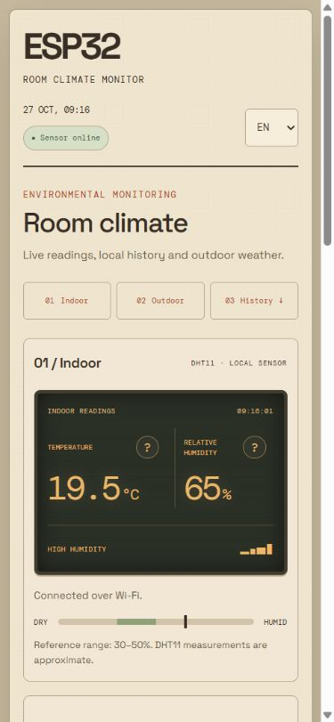
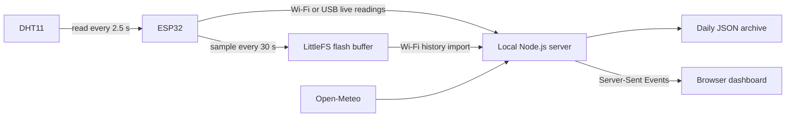

<div align="center">

# ESP32 Room Climate Monitor

Temperature and humidity monitoring with autonomous logging and a local web dashboard.

[](https://github.com/lsvt-commits/esp32-room-climate-monitor/actions/workflows/checks.yml)


[Overview](#overview) · [Setup](#setup) · [Hardware](docs/hardware.md) · [Architecture](docs/architecture.md) · [Tests](#tests)

</div>



## Overview

An ESP32 reads a DHT11 sensor and records temperature and relative humidity to flash memory. A local Node.js server imports the readings, stores them by date and provides a responsive dashboard at `localhost:8000`.

The device keeps recording while the computer is off. When the server starts again, it retrieves missing samples over Wi-Fi. Outdoor weather from Open-Meteo provides context for changes in indoor conditions.

| Feature | Description |
|---|---|
| Live readings | Temperature and relative humidity every 2.5 seconds. Wi-Fi is preferred, with USB as a fallback. |
| Autonomous logging | One sample every 30 seconds, stored in a persistent circular buffer on the ESP32. |
| Synchronization | Automatic Wi-Fi import with stable sample identifiers to prevent duplicates. |
| Local history | Daily JSON files without automatic expiration, date/time selection and 1/6/24-hour views. |
| Chart inspection | Mouse, touch, keyboard and button controls. Gaps longer than 90 seconds are not interpolated. |
| Outdoor comparison | Current weather, temperature difference and absolute humidity comparison. |
| Export | CSV for the selected interval and a PNG snapshot of the current reading. |
| Languages | English by default, with an EN/IT selector and a saved browser preference. |

## Measurement history



Select a date and starting time, then move between intervals with the navigation buttons. The chart displays minimum, maximum and net change for the selected period.

<details>
<summary><strong>Mobile interface</strong></summary>

<br>
<div align="center">

</div>

The layout has been checked from 320 to 1440 px and in landscape orientation. Touch targets are at least 44 px. The SVG chart recalculates its geometry instead of scaling down desktop labels. Indoor/Outdoor/History links appear only in single-column layouts.

The server listens on the computer's loopback interface. Responsive layout does not enable network access: `localhost` on a phone refers to the phone itself.

</details>

## Architecture



The device buffer holds **20,160 samples**, approximately **seven days** at 30-second intervals. Once full, it overwrites the oldest samples. Start the server at least once every seven days to import them before they are overwritten.

The ESP32 must remain powered to collect data. Samples already written to flash survive a restart. The computer archive has no automatic retention limit. History synchronization requires Wi-Fi and the configured device token; USB provides an alternative for live readings.

## Setup

### Requirements

- Node.js **22 or later** and npm.
- Python 3 with `pyserial` for USB communication.
- A classic ESP32 Dev Module and a three-pin DHT11 module.
- Arduino IDE or Arduino CLI with **ESP32 core 3.3.12**, **DHT sensor library 1.4.6** and **Adafruit Unified Sensor 1.1.15**.

### 1. Install

```sh
git clone https://github.com/lsvt-commits/esp32-room-climate-monitor.git
cd esp32-room-climate-monitor
npm ci
python -m pip install -r requirements.txt
```

Use `python3` where required. The server uses `python3` on macOS/Linux and `python` on Windows. Set `CLIMATE_PYTHON` to select another interpreter.

### 2. Configure and upload the firmware

Copy `room_climate/wifi_secrets.example.h` to `room_climate/wifi_secrets.h`. Set the Wi-Fi SSID, password and a random device token. Generate a token with:

```sh
node -e "console.log(require('node:crypto').randomBytes(32).toString('hex'))"
```

Compile and upload:

```sh
arduino-cli compile --fqbn esp32:esp32:esp32 room_climate
arduino-cli upload --fqbn esp32:esp32:esp32 --port COM3 room_climate
```

Replace `COM3` with your device's port. See [hardware setup](docs/hardware.md) for wiring and library installation.

### 3. Configure synchronization

Create `storage/` and copy `config/network.example.json` to `storage/network.json`:

```json
{
  "hostname": "esp32-stanza.local",
  "ip": "",
  "token": "THE_SAME_RANDOM_TOKEN_AS_THE_FIRMWARE"
}
```

The hostname is retained for compatibility with installed firmware. The server discovers the device through mDNS. If discovery is unavailable, enter the device's private IP in `ip`. The computer and device must be reachable on the same network.

If device storage is not ready, follow the [first-time initialization procedure](docs/architecture.md#first-time-storage-initialization).

### 4. Start

```sh
npm start
```

Open **[http://localhost:8000](http://localhost:8000)**. “History synchronized” indicates that the available device samples have been imported.

For USB, close the Arduino Serial Monitor. If several USB boards are connected, select the correct port:

```powershell
# Windows PowerShell
$env:CLIMATE_SERIAL_PORT = "COM3"
npm start
```

```sh
# macOS / Linux
CLIMATE_SERIAL_PORT=/dev/ttyUSB0 npm start
```

## Data and configuration

| Path | Contents |
|---|---|
| `storage/diary/YYYY-MM-DD.json` | Daily samples, grouped in the Europe/Rome time zone. |
| `storage/sync.json` | Last imported device sequence. |
| `storage/settings.json` | Selected weather location. |
| `storage/network.json` | Device address and token. |
| `room_climate/wifi_secrets.h` | Wi-Fi credentials and firmware token. |

Credentials, personal history and compiled firmware are excluded from Git. Firmware binaries may contain the values from `wifi_secrets.h` and should not be published.

Indoor measurements remain on the device and computer. Weather requests send the selected city's coordinates to Open-Meteo. The interface loads fonts from Google Fonts, with system-font fallbacks. Language preference is stored in the browser.

## Tests

```sh
npm run check
npm test
npm run test:ui
```

Tests cover reading validation, absolute humidity, daily storage, repeated imports, backup recovery, Europe/Rome dates, mDNS, history navigation, language switching and contextual guidance. GitHub Actions runs the checks on Linux and Windows.

Autonomous recording, persistence across a device restart and subsequent import have also been checked on physical hardware. Automated tests do not replace wiring and sensor checks.

## Project structure

```text
esp32-room-climate-monitor/
├── room_climate/       # ESP32 firmware and persistent logger
├── public/             # Dashboard, translations, chart and PNG export
├── tools/              # USB bridge, history store, mDNS and tests
├── config/             # Example device configuration
├── docs/               # Hardware, architecture and screenshots
├── server.cjs          # Local API, synchronization and event stream
└── storage/            # Created locally; excluded from Git
```

## Limitations

- The DHT11 has limited accuracy. Decimal places do not imply equivalent measurement precision.
- Guidance is general information about indoor conditions. The application does not control heating or dehumidifiers.
- Samples from the current boot can be dated after clock synchronization. Undated samples from an earlier boot are not assigned invented timestamps.
- Device flash is a temporary buffer, not a replacement for computer backups.
- The server is intended for local use and is not configured for public Internet exposure.
