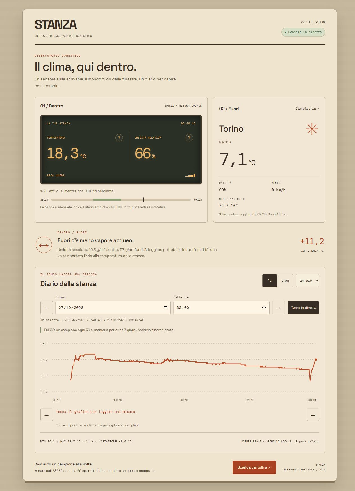
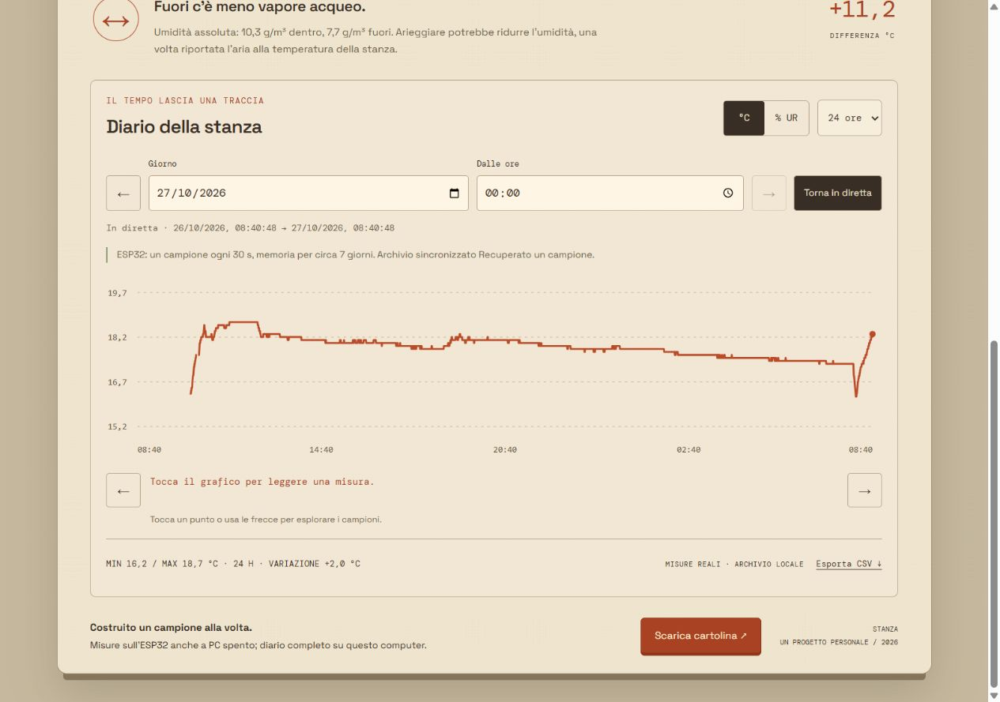
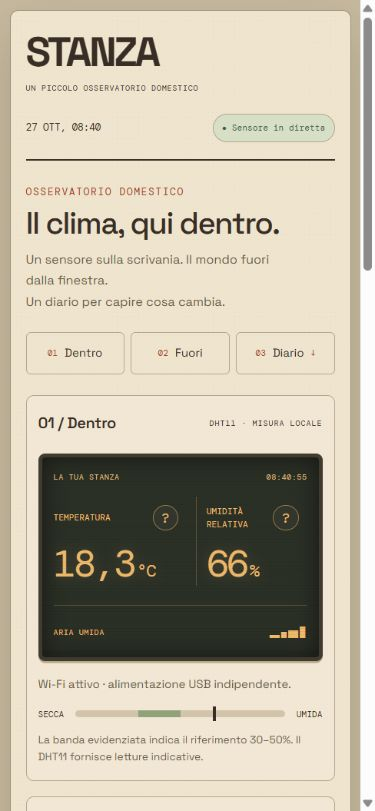
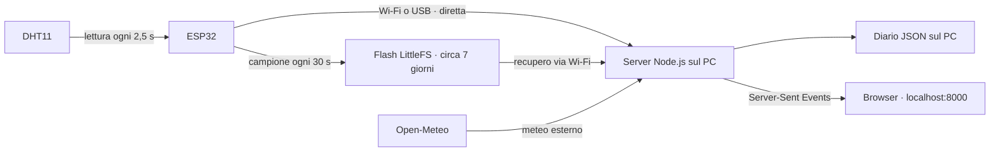

<div align="center">

# STANZA

### Il clima, qui dentro.

Un sensore sulla scrivania. Il mondo fuori dalla finestra.<br>
Un diario per capire cosa cambia.

[](https://github.com/lsvt-commits/stanza/actions/workflows/checks.yml)


[Il progetto](#il-progetto) · [Come funziona](#come-funziona) · [Avvio](#avvio) · [Hardware](docs/hardware.md) · [Architettura](docs/architecture.md)

</div>



## Il progetto

STANZA è un piccolo osservatorio domestico: un **ESP32 con un DHT11** misura temperatura e umidità della stanza; un’applicazione locale raccoglie i dati, li mette a confronto con il meteo esterno e li conserva in un diario navigabile.

Nasce da domande molto concrete: *la stanza sta davvero iniziando a scaldarsi? Cosa succede durante la notte? L’umidità scende dopo aver aperto la finestra?* Il grafico serve a seguire questi cambiamenti nel tempo.

L’interfaccia riprende carta, strumenti da banco e display ambrati. HTML, CSS e JavaScript vanilla, con un server Node.js senza dipendenze di produzione.

### Cosa fa

| | |
|---|---|
| **Dentro** | Temperatura e umidità reali, aggiornate ogni 2,5 secondi, con stato del sensore e consigli contestuali. |
| **Fuori** | Meteo della città scelta tramite Open-Meteo, con temperatura, umidità, vento e minime/massime. |
| **Confronto** | Differenza di temperatura e confronto dell’umidità assoluta: due percentuali relative, da sole, non raccontano tutta la storia. |
| **Diario** | Data e ora selezionabili, finestre di 1/6/24 ore, minimo, massimo, variazione e lettura dei singoli campioni. |
| **PC spento** | La scheda conserva un campione ogni 30 secondi nella propria flash, anche senza il programma sul PC. |
| **Al ritorno** | STANZA importa automaticamente i campioni mancanti via Wi-Fi, senza duplicarli. |
| **Esportazione** | CSV del periodo visualizzato e cartolina PNG della lettura attuale. |

## Un diario da esplorare



Scegli un giorno, imposta l’ora iniziale e spostati con le frecce. Sul grafico puoi usare mouse, tocco, tastiera o pulsanti per leggere una misura precisa. Le interruzioni più lunghe di 90 secondi rimangono visibili: il grafico non inventa misure nei vuoti.

<details>
<summary><strong>Anche su schermi piccoli</strong></summary>

<br>
<div align="center">

</div>

Layout a colonna, aree di tocco da almeno 44 px, grafico che ricalcola la propria geometria, dialoghi scorrevoli e navigazione rapida Dentro/Fuori/Diario solo sotto gli 801 px. Il layout è stato controllato nel browser da 320 a 1440 px e anche in orizzontale.

Il server ascolta soltanto sul PC: `localhost` sul telefono indica il telefono stesso. La versione responsive non abilita automaticamente l’accesso dalla rete domestica.

</details>

## Come funziona



La memoria della scheda è **circolare**: contiene fino a **20.160 campioni**, circa sette giorni a intervalli di 30 secondi. Poi riutilizza lo spazio dei campioni più vecchi. Sul PC, invece, il diario non ha una scadenza automatica.

Per conservare l’intera serie, avvia STANZA almeno ogni sette giorni e lascia terminare la sincronizzazione. L’ESP32 deve restare alimentato; quando viene tolta corrente, i campioni già scritti rimangono in memoria, ma non vengono raccolte nuove misure.

La sincronizzazione dello storico richiede il Wi-Fi e il token configurato. L’USB è un’alternativa per le letture in diretta.

## Avvio

### 1. Requisiti

- Node.js **22 o successivo** e npm.
- Python 3 con `pyserial` per il collegamento USB.
- ESP32 classico e modulo DHT11 a tre pin.
- Arduino IDE o Arduino CLI con core **ESP32 3.3.12** e librerie **DHT sensor library 1.4.6** e **Adafruit Unified Sensor 1.1.15**.

### 2. Clona e installa

```sh
git clone https://github.com/lsvt-commits/stanza.git
cd stanza
npm ci
python -m pip install -r requirements.txt
```

Su macOS/Linux il comando Python potrebbe essere `python3`. Il server usa `python3` su questi sistemi e `python` su Windows; puoi indicare un interprete diverso con `STANZA_PYTHON`.

### 3. Configura la scheda

Copia `room_climate/wifi_secrets.example.h` in `room_climate/wifi_secrets.h` e inserisci nome della rete, password e un token casuale. Puoi generare il token con:

```sh
node -e "console.log(require('node:crypto').randomBytes(32).toString('hex'))"
```

Poi compila e carica il firmware:

```sh
arduino-cli compile --fqbn esp32:esp32:esp32 room_climate
arduino-cli upload --fqbn esp32:esp32:esp32 --port COM3 room_climate
```

Sostituisci `COM3` con la porta della tua scheda. [Collegamenti e preparazione dell’hardware →](docs/hardware.md)

### 4. Collega il programma al dispositivo

Crea la cartella `storage/` e copia `config/network.example.json` in `storage/network.json`:

```json
{
  "hostname": "esp32-stanza.local",
  "ip": "",
  "token": "LO_STESSO_TOKEN_INSERITO_NEL_FIRMWARE"
}
```

Il dispositivo viene cercato tramite mDNS; se la tua rete non lo risolve, puoi indicare il suo IP privato nel campo `ip`. PC e scheda devono raggiungersi sulla stessa rete. Alla prima installazione verifica lo stato della memoria nella pagina: se non è pronta, consulta la sezione [inizializzazione](docs/architecture.md#prima-inizializzazione-della-memoria).

### 5. Avvia STANZA

```sh
npm start
```

Apri **[http://localhost:8000](http://localhost:8000)**. Quando appare “Archivio sincronizzato”, i campioni disponibili sulla scheda sono stati importati.

Per l’USB, chiudi il Serial Monitor di Arduino. Se sono collegate più schede, specifica quella corretta:

```powershell
# PowerShell
$env:STANZA_SERIAL_PORT = "COM3"
npm start
```

```sh
# macOS / Linux
STANZA_SERIAL_PORT=/dev/ttyUSB0 npm start
```

## Dati e configurazione

| Percorso | Contenuto |
|---|---|
| `storage/diary/AAAA-MM-GG.json` | Campioni archiviati per giorno, nel fuso Europe/Rome. |
| `storage/sync.json` | Posizione dell’ultima importazione dal dispositivo. |
| `storage/settings.json` | Città selezionata. |
| `storage/network.json` | Configurazione locale e token della scheda. |
| `room_climate/wifi_secrets.h` | Credenziali Wi-Fi e token usati dal firmware. |

**Credenziali, storico personale e binari compilati sono esclusi da Git.** I binari del firmware possono contenere i valori di `wifi_secrets.h`: non vanno pubblicati. Nel repository ci sono soltanto file di esempio.

Le misure della stanza non vengono inviate a un servizio cloud. Il meteo esterno richiede richieste a Open-Meteo con le coordinate della città scelta. L’interfaccia carica i font da Google Fonts, con caratteri di sistema come alternativa.

## Verifiche

```sh
npm run check
npm test
npm run test:ui
```

I test coprono validazione delle letture, calcolo dell’umidità assoluta, archivio giornaliero, importazioni ripetute, recupero da backup, date Europe/Rome, mDNS, navigazione del diario e consigli contestuali. GitHub Actions li esegue su Linux e Windows.

La raccolta autonoma, la conservazione dopo un riavvio e il recupero nel diario sono stati verificati anche sull’ESP32 reale. I test automatici non sostituiscono il controllo dei collegamenti e del sensore.

## Struttura

```text
stanza/
├── room_climate/       # Firmware ESP32 e registratore persistente
├── public/             # Interfaccia, grafico, consigli e cartolina
├── tools/              # Ponte USB, archivio, mDNS e test
├── config/             # Esempio di configurazione della rete
├── docs/               # Hardware, architettura e screenshot
├── server.cjs          # API locali, sincronizzazione e flusso eventi
└── storage/            # Creato localmente, escluso da Git
```

## Limiti da conoscere

- Il DHT11 è un sensore indicativo: piccoli decimali non equivalgono alla stessa precisione reale.
- I consigli descrivono condizioni domestiche generali; STANZA non controlla termosifoni o deumidificatori.
- Senza un’ora affidabile, i campioni del boot corrente possono essere ricostruiti alla sincronizzazione. Quelli senza data certa di un avvio precedente non ricevono timestamp inventati.
- La memoria della scheda non sostituisce un backup del diario sul PC.
- Il server è pensato per uso locale e non è configurato per l’esposizione pubblica su Internet.

<div align="center">

---

**STANZA** · Costruito un campione alla volta.<br>
[lsvt-commits](https://github.com/lsvt-commits)

</div>
